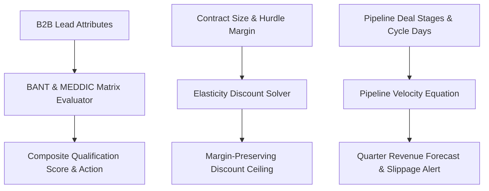

# genpark-sales-agent


GenPark Sales Agent is a B2B revenue and commercial negotiation engine implementing BANT and MEDDIC multi-criteria lead scoring, margin-bounded price elasticity discount ceiling solving, and pipeline velocity forecasting with stage dwell-time slippage detection.



## Features
- **BANT + MEDDIC Qualification**: Computes structured 0-100 lead scores mapping deals to SQL, SAL, and automated nurture paths.
- **Discount Ceiling Optimizer**: Calculates maximum permissible pricing concessions ensuring gross margins never breach hurdle rates.
- **Pipeline Velocity Forecaster**: Models revenue velocity $V = (N \times W \times S) / L$ and automatically alerts on stage stall slippage.

## MCP Runtime Requirements

Use Python 3.10+ for the MCP server. The core `client.py` has no external dependencies; MCP transport requires `mcp>=1.0.0,<2`. From this checkout, install it into the Python environment used by your MCP client:

```bash
python -m pip install -r requirements.txt
```

Use the same Python interpreter to launch `mcp_server.py`. In desktop client configuration, set `command` to that interpreter's absolute path.

## Quickstart

```python
from client import GenParkSalesAgent

agent = GenParkSalesAgent()
res = agent.calculate_price_elasticity_and_discount_ceiling(100000.0, "enterprise", competitor_pressure_score=0.6)
print("Recommended Discount:", res["recommended_discount_pct"], "%")
```

## Local MCP Server

After installing the MCP requirements, launch the local STDIO server:

```bash
python mcp_server.py
```

Point your MCP client at the absolute path to `mcp_server.py` using the same Python interpreter. This repository does not provide a hosted MCP endpoint.

## License
MIT
