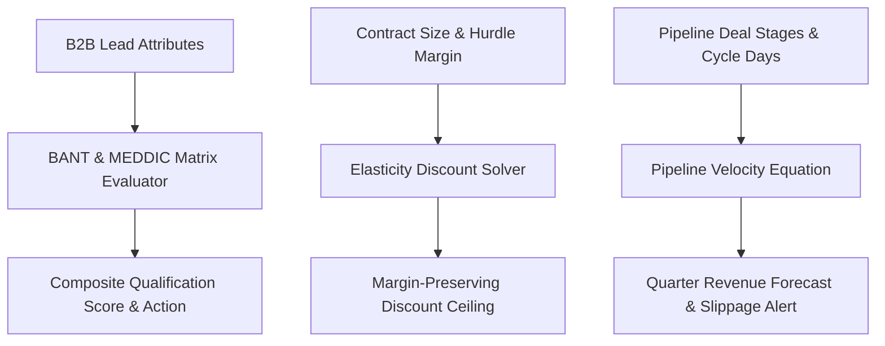

# genpark-sales-agent


GenPark Sales Agent is a zero-dependency B2B revenue and commercial negotiation engine implementing BANT and MEDDIC multi-criteria lead scoring, margin-bounded price elasticity discount ceiling solving, and pipeline velocity forecasting with stage dwell-time slippage detection.



## Features
- **BANT + MEDDIC Qualification**: Computes structured 0-100 lead scores mapping deals to SQL, SAL, and automated nurture paths.
- **Discount Ceiling Optimizer**: Calculates maximum permissible pricing concessions ensuring gross margins never breach hurdle rates.
- **Pipeline Velocity Forecaster**: Models revenue velocity $V = (N \times W \times S) / L$ and automatically alerts on stage stall slippage.

## Quickstart

```python
from client import GenParkSalesAgent

agent = GenParkSalesAgent()
res = agent.calculate_price_elasticity_and_discount_ceiling(100000.0, "enterprise", competitor_pressure_score=0.6)
print("Recommended Discount:", res["recommended_discount_pct"], "%")
```

## License
MIT
